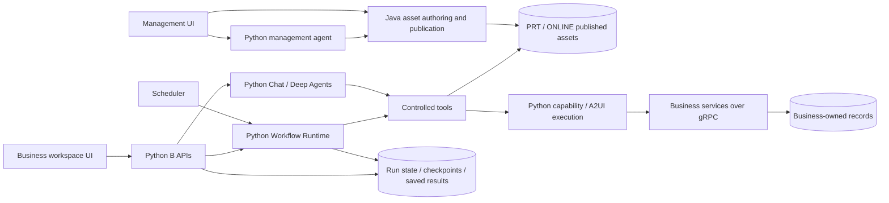

# Current implementation / 当前实现架构

Snapshot: 2026-10-20. This document describes the implemented responsibilities and important limits. Historical architecture guides remain design records, not current capability assertions.

## Components

M means management, not mobile. B means the user-facing business workspace. These are responsibility boundaries, not a requirement for one process per directory. The shared account host remains Python. Java publishes runtime materials directly; an old Python publication bridge is not the current publication path.

## Follow the source

| Question | Code entry |
| --- | --- |
| Is Deep Agents actually used? | [assembly.py](../services/agent-workflow-runtime/src/agent_workflow_runtime/assembly.py) calls `create_deep_agent` |
| Is LangGraph actually used? | [workflow_loader.py](../services/agent-workflow-runtime/src/agent_workflow_runtime/workflow_loader.py) builds `StateGraph`; [langgraph_adapter.py](../services/agent-workflow-runtime/src/agent_workflow_runtime/langgraph_adapter.py) resumes matching native interrupts |
| Who owns lifecycle/control deduplication? | [native_control.py](../services/agent-workflow-runtime/src/agent_workflow_runtime/native_control.py), [lifecycle.py](../services/agent-workflow-runtime/src/agent_workflow_runtime/lifecycle.py) |
| How do saved results enter chat? | [chat/workflow_results.py](../services/agent-workflow-runtime/src/agent_workflow_runtime/chat/workflow_results.py) |
| Who owns handling and completion records? | [processing_tasks.py](../services/b-side-api/src/a2flow_bside/processing_tasks.py) |
| Where is authenticated API assembly? | [B app.py](../services/b-side-api/src/a2flow_bside/app.py), [accounts host](../deploy/accounts/app.py) |

## What happens when input is missing?

The model can request a temporary interaction through the registered generation tool. The saved card belongs to a particular conversation or workflow task/node. Rendering a card does not finish that task. A valid submission is checked against ownership, live state and the interaction contract; the persisted result resumes its owning execution, and the next model turn sees the supplied input. Refresh reads saved records; it is not permission to replay an operation.

Temporary interaction is a short-lived UI within a conversation, not a separately installed business application. Preconfigured A2UI assets remain another supported path. The model may choose tools and propose parameters, but the service owns identity, environment, resource authorization and actual outcomes.

## Scheduling and chat are not a parent-child assumption

A scheduled workflow can run without a parent conversation. Its saved result/attention has an independent identity. The B workspace presents it in the activity rail; an explicit user action attaches a source-bound result reference to chat. Read-only discussion uses saved facts. If the user asks to take action, a separate handling task links subsequent tool receipts back to that source. Viewing a reminder, completing that task and resolving the original business issue are separate transitions.

## Consistency and failure boundaries

| Boundary | What is guaranteed / what is not |
| --- | --- |
| Identity and environment | Derived from trusted service context; model-supplied arbitrary identity is not accepted |
| Publication | Environment-separated published materials and management history; runtime reads the current effective publication |
| Control IDs | Deduplicate the platform control request; do not make external business effects exactly-once |
| Stop | Prevents new work and continuation after acceptance; already-dispatched writes may still complete |
| Unknown external outcome | Retained as uncertain; no generic automatic replay or compensation |
| Model end vs task end | A model stream ending does not satisfy a pending interaction or all required workflow states |
| Handling completion | Requires a completed/appropriate final delivery and settled operations; an early returned tool is not enough |
| Notifications | Lifecycle state and scheduler outbox commit together; stable identities deduplicate repeated delivery. Native waiting checkpoints use bounded read-only recovery, not business replay |

The workflow factory allocates a run before constructing the graph. Setup failure must therefore fail the allocated run even when a graph object does not exist. Late failure must not overwrite STOPPED/SUCCEEDED or publish a contradictory failure event. This is covered by the targeted failure-boundary evidence linked in the roadmap.

The engine accepts a transaction-scoped event writer from deployment assembly rather than importing the scheduler. Terminal events share the run transaction. Waiting checkpoints belong to LangGraph, so recovery reads the actual native interrupt, checks the current run/interaction under lock and queues a stable waiting event. This is eventual projection recovery across separate persistence boundaries, not a distributed transaction or exactly-once business execution. External notification outcomes that are uncertain remain UNKNOWN.

## Chat turn admission and recovery

The product message API uses `POST /api/conversations/messages` with `conversationId` and `clientRequestId` in JSON, and `GET /api/conversations/messages?conversationId=...`. Resource ownership is still checked. Old path-based message URLs are removed, so frontend and backend must be released together. Other conversation/card routes are unchanged.

B accepts the message pair, typed source identity and dispatch intent in one transaction. `chat_turns` is the single product turn registry; `processing_task_id` relates handling work to that turn. `chat_requests` retains the many-client-request-to-one-turn relationship and checks content digests. A card completion saves `chat_continuations` in the same transaction as its real result. Pending/materialized/review are one state field, not an in-memory callback promise.

Runtime owns execution admission and checkpoints. `agent_conversations` retains only identity and thread association. Under the same session advisory lock, unfinished `agent_chat_turns` block new execution; the latest completed result and actual checkpoint establish continuation evidence. Missing checkpoints and unknown outcomes never authorize replay. The Agent model/tool loop belongs only to Deep Agents.

A shared, typed pure result accumulator produces the complete versioned result saved in `agent_chat_turns.result` before the native lock is released. B uses the same accumulator for live delivery. NOT_STARTED may execute; BUSY defers; COMPLETED binds the saved result to the original product messages and repairs their projection directly; NEEDS_REVIEW never calls the model or business tool again. Completed recovery does not replay token events. The result preserves model/tool records, ordered text/cards, personal Workflow registration and actual terminal facts, with structural and checksum validation.

Final assistant display and `chat_turns.COMPLETED` commit atomically under `dispatch_generation` fencing. `waiting_action` ends this Agent turn while awaiting interaction; it does not mean the business task or entire Workflow is complete. Product relations and `messages.content.delivery` remain display concerns. `processing_tasks`, actual operation receipts and approval consumption remain distinct records.

`chat_turn_events` remains the SSE delivery journal. Journal sequence is independent of the result accumulator's event sequence, and writes are checked against the current dispatch generation. Re-subscribing reads saved facts. The stream may repair a missing terminal event with its committed final projection; it never starts execution. This is not a claim of immutable Event Sourcing or business exactly-once.

The durable dispatcher is owned by application lifespan. Successful local admission/card completion and continuation materialization send a bounded process-local wake hint; the hint never replaces the database row, lock or Runtime inspection. An initial pass, slot release, eligible retry deadline and a 30-second reconciliation deadline drive further reads. Full capacity waits for owned task completion, while SQL excludes active conversations before applying its candidate limit. Other processes and missed hints remain covered by database reconciliation; there is no cross-worker notification bus. A wake port binds once and closes permanently; a new application lifetime uses a new object. Thread notification coalescing and the drain/wait version check remain. See [single-use lifetime](../openspec/changes/chat-wake-lifetime/proposal.md). SSE only subscribes to committed delivery facts. See [dispatch wake design](../openspec/changes/chat-dispatch-wake/proposal.md).

Only the latest schema is supported. Removed tables/columns and previous result protocols are not migrated or accepted as compatible. Startup rejects incompatible existing structures without deleting history. See the [latest schema contract](../openspec/changes/chat-state-convergence/design.md), [checks and limits](../openspec/changes/chat-state-convergence/regression.md) and [scoped readiness](../openspec/changes/chat-state-convergence/readiness.md). Source implementation does not imply that an existing public database has been reset, upgraded or deployed.

## Product scope versus earlier targets

The current product loader accepts **1–8 sequential nodes plus an optional summary**. Native framework experiments and historical proposals include branching/parallel behavior; they do not prove arbitrary DAG support in the shipped authoring-to-execution path. No cluster failover benchmark, throughput claim, autonomous rollback or unrestricted backend-code generation is claimed.

The currently demonstrated content/personnel examples use independently maintained example services and synthetic records. New business domains require real registered adapters and permissions; generating a Workflow cannot implement or deploy a new backend service.

For replication limits and priority debt, read [quality roadmap](quality-roadmap.md). For a concise technical presentation, read [portfolio walkthrough](portfolio-walkthrough.md).

## Explicit Python HTTP composition

B HTTP now uses typed domain routers and small Chat/Workflow application services.
`create_app` retains authentication/query guards, errors and lifespan; it receives
concrete repositories plus supported typed stream/callback ports. Production
`deploy.realchat.launcher` still delegates to attended composition. Runtime HTTP
and progress factories keep their smaller layout with explicit service/lane types.
See [code navigation](../openspec/changes/python-dependency-routes/navigation.md),
[scope inventory](../openspec/changes/python-dependency-routes/inventory.md) and
[verification limits](../openspec/changes/python-dependency-routes/regression.md).
This is source organization and type coverage, not a new execution engine.
