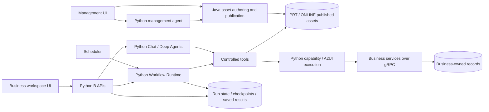

# Current implementation / 当前实现架构

Snapshot: 2026-10-20. This document describes the implemented responsibilities and important limits. Historical architecture guides remain design records, not current capability assertions.

## Components

M means management, not mobile. B means the user-facing business workspace. These are responsibility boundaries, not a requirement for one process per directory. The shared account host remains Python. Java publishes runtime materials directly; an old Python publication bridge is not the current publication path.

## Follow the source

| Question | Code entry |
| --- | --- |
| Is Deep Agents actually used? | [assembly.py](../services/agent-workflow-runtime/src/agent_workflow_runtime/assembly.py) calls `create_deep_agent` |
| Is LangGraph actually used? | [workflow_loader.py](../services/agent-workflow-runtime/src/agent_workflow_runtime/workflow_loader.py) builds `StateGraph`; [langgraph_adapter.py](../services/agent-workflow-runtime/src/agent_workflow_runtime/langgraph_adapter.py) resumes matching native interrupts |
| Who owns lifecycle/control deduplication? | [native_control.py](../services/agent-workflow-runtime/src/agent_workflow_runtime/native_control.py), [lifecycle.py](../services/agent-workflow-runtime/src/agent_workflow_runtime/lifecycle.py) |
| How do saved results enter chat? | [chat/workflow_results.py](../services/agent-workflow-runtime/src/agent_workflow_runtime/chat/workflow_results.py) |
| Who owns handling and completion records? | [processing_tasks.py](../services/b-side-api/src/a2flow_bside/processing_tasks.py) |
| Where is authenticated API assembly? | [B app.py](../services/b-side-api/src/a2flow_bside/app.py), [accounts host](../deploy/accounts/app.py) |

## What happens when input is missing?

The model can request a temporary interaction through the registered generation tool. The saved card belongs to a particular conversation or workflow task/node. Rendering a card does not finish that task. A valid submission is checked against ownership, live state and the interaction contract; the persisted result resumes its owning execution, and the next model turn sees the supplied input. Refresh reads saved records; it is not permission to replay an operation.

Temporary interaction is a short-lived UI within a conversation, not a separately installed business application. Preconfigured A2UI assets remain another supported path. The model may choose tools and propose parameters, but the service owns identity, environment, resource authorization and actual outcomes.

## Scheduling and chat are not a parent-child assumption

A scheduled workflow can run without a parent conversation. Its saved result/attention has an independent identity. The B workspace presents it in the activity rail; an explicit user action attaches a source-bound result reference to chat. Read-only discussion uses saved facts. If the user asks to take action, a separate handling task links subsequent tool receipts back to that source. Viewing a reminder, completing that task and resolving the original business issue are separate transitions.

## Consistency and failure boundaries

| Boundary | What is guaranteed / what is not |
| --- | --- |
| Identity and environment | Derived from trusted service context; model-supplied arbitrary identity is not accepted |
| Publication | Environment-separated published materials and management history; runtime reads the current effective publication |
| Control IDs | Deduplicate the platform control request; do not make external business effects exactly-once |
| Stop | Prevents new work and continuation after acceptance; already-dispatched writes may still complete |
| Unknown external outcome | Retained as uncertain; no generic automatic replay or compensation |
| Model end vs task end | A model stream ending does not satisfy a pending interaction or all required workflow states |
| Handling completion | Requires a completed/appropriate final delivery and settled operations; an early returned tool is not enough |
| Notifications | Status and event sink currently use different transactions; a failure window remains (see roadmap) |

The workflow factory allocates a run before constructing the graph. Setup failure must therefore fail the allocated run even when a graph object does not exist. Late failure must not overwrite STOPPED/SUCCEEDED or publish a contradictory failure event. This is covered by the targeted failure-boundary evidence linked in the roadmap.

## Product scope versus earlier targets

The current product loader accepts **1–8 sequential nodes plus an optional summary**. Native framework experiments and historical proposals include branching/parallel behavior; they do not prove arbitrary DAG support in the shipped authoring-to-execution path. No cluster failover benchmark, throughput claim, autonomous rollback or unrestricted backend-code generation is claimed.

The currently demonstrated content/personnel examples use independently maintained example services and synthetic records. New business domains require real registered adapters and permissions; generating a Workflow cannot implement or deploy a new backend service.

For replication limits and priority debt, read [quality roadmap](quality-roadmap.md). For a concise technical presentation, read [portfolio walkthrough](portfolio-walkthrough.md).
